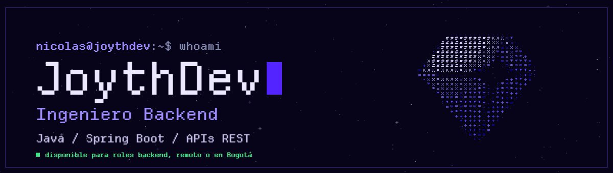
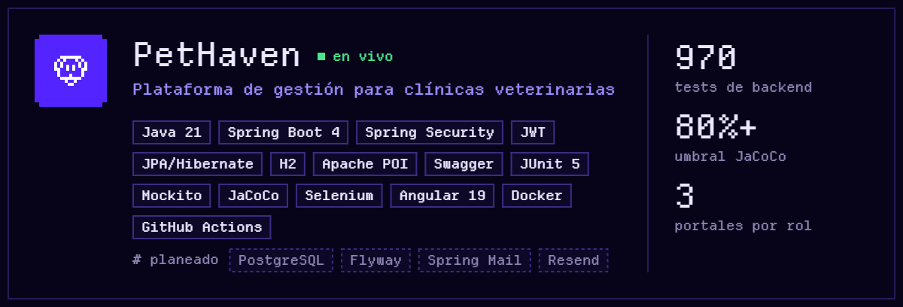
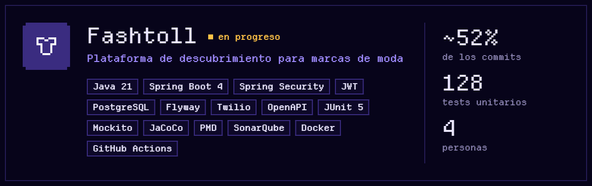
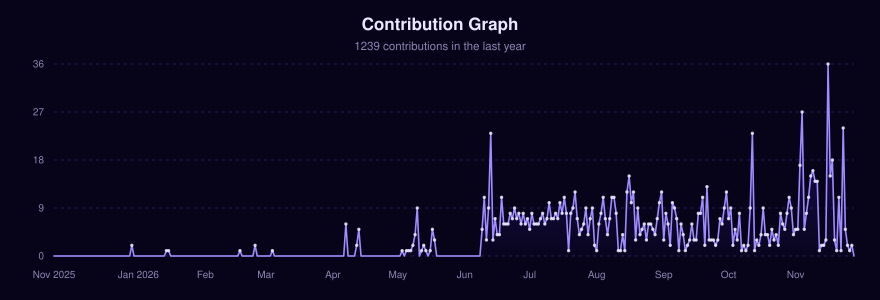

<a href="README.md">English</a> · <b>Español</b>

  
  
  
  

### `~/sobre-mí`

Construyo **sistemas backend robustos y escalables** con Java y Spring Boot, y me importa lo que sucede después de escribir el código: probarlo, desplegarlo, observarlo y que sea realmente útil para alguien.

- Basado en **Bogotá, Colombia**, abierto a prácticas y roles junior remotos.
- Estudiante de **Ingeniería de Sistemas** en la **Pontificia Universidad Javeriana**, especializándome de forma independiente como ingeniero backend.
- Inmerso en el ecosistema **Java + Spring Boot**: APIs REST, Spring Security, testing, persistencia.
- Aprendiz constante más allá del código: **despliegue, QA, DevOps, estrategias de testing y desarrollo agéntico**.
- Meta: unirme a un equipo donde pueda entregar **servicios confiables que generen valor rápido**, y crecer hacia la ingeniería de producto.

### `~/principios`

Quiero ir más allá de escribir código; quiero construir productos. Mi brújula:

- **Primero el valor.** La mejor solución es la que resuelve un problema real rápido, no la más elegante que no resuelve nada.
- **Calidad como hábito.** Testing (JUnit 5, Mockito), principios SOLID, código limpio, análisis estático. Los bugs detectados temprano son baratos.
- **Entregarlo.** Apps containerizadas, pipelines de CI/CD y conciencia de despliegue. El software solo genera valor cuando corre en producción.
- **Pensar en sistemas.** Estudiando arquitectura de software, diseño de sistemas y sistemas distribuidos para entender *por qué* escalan las cosas, no solo *cómo*.

### `~/proyectos`

Proyectos del mundo real para afilar mi oficio, de la idea a un producto probado, seguro y desplegable.

Un sistema fullstack que digitaliza una clínica veterinaria especializada en la **hospitalización de perros y gatos**: una **API REST** en Spring Boot consumida por una **SPA en Angular** con tres portales según el rol. Los veterinarios registran tratamientos con descuento automático de inventario y descargan historias clínicas en PDF; los dueños siguen a sus mascotas hospitalizadas; los administradores gestionan el equipo, el inventario de medicamentos (con importación desde Excel) y los KPIs del negocio.

- **Estado:** entregas 1–3 completas y **[en producción](https://pethaven-zeta.vercel.app)** (SPA en Vercel, API en Render), con 2 casos E2E con Selenium y un pipeline de CI con GitHub Actions. El despliegue y la infraestructura se siguen refinando.
- **Mi rol:** **líder de backend de un equipo de cuatro personas** y quien más aporta al repositorio. Diseñé el modelo de dominio con JPA/Hibernate, lideré la migración de Thymeleaf a una API REST por capas (DTOs, validaciones, errores centralizados, Swagger), construí los endpoints de KPIs, la gestión de medicamentos con importación desde Excel y la suite de pruebas del backend, y fui quien más aportó a la capa de seguridad: Spring Security con login JWT, contraseñas BCrypt y la matriz de permisos por rol y por recurso propio.

Una plataforma en Spring Boot que conecta marcas de moda locales con compradores conscientes: perfiles de marca, catálogo y búsqueda de productos, listas de deseos, seguimiento de marcas y reseñas. Nació como un proyecto universitario de cuatro personas para CEIBA, una empresa ficticia, y ahora lo estoy rediseñando como un backend de nivel productivo.

- **Mi rol:** desarrollador backend, product owner y configuration manager; principal contribuidor del repositorio.
- Construí de punta a punta los módulos de lista de deseos, marcas seguidas y reseñas de productos y marcas (entidades, DTOs, mappers, servicios y endpoints REST), agregué notificaciones por SMS con Twilio y configuré los pipelines de CI/CD, los reportes de cobertura con JaCoCo y la documentación de la API publicada automáticamente con Scalar.

### `~/estadísticas`

  
  

  

  <picture>
    <source media="(prefers-color-scheme: dark)" srcset="https://raw.githubusercontent.com/JoythDev/JoythDev/output/github-contribution-grid-snake-dark.svg">
    <source media="(prefers-color-scheme: light)" srcset="https://raw.githubusercontent.com/JoythDev/JoythDev/output/github-contribution-grid-snake.svg">
    
  </picture>

### `~/contacto`

Hablemos de desarrollo backend, arquitectura o tecnología en general: **[nicolas.joya.dev@gmail.com](mailto:nicolas.joya.dev@gmail.com)** o **[LinkedIn](https://www.linkedin.com/in/nicolas-joya/)**. Más sobre mi trabajo en **[joythdev-portfolio.vercel.app/es](https://joythdev-portfolio.vercel.app/es/)**.

<em>"El código se ha vuelto una commodity; la arquitectura de sistemas, las restricciones y el contexto de negocio son las verdaderas fronteras de la ingeniería."</em>

<strong>¡Gracias por visitar! Siéntete libre de explorar mis repositorios.</strong>

