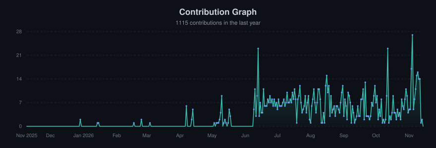

<b>English</b> · <a href="README.es.md">Español</a>

<h1 align="center">Hi, I'm Nicolas Joya 👋</h1>

  

<h3 align="center">☕ Backend Engineer · Java & Spring Boot · Bogotá → Remote-friendly</h3>

  
  
  

I build <strong>robust, scalable backend systems</strong> with Java and Spring Boot — and I care about what happens after the code is written: tested, deployed, observed, and actually useful to someone.

---

### 📖 About Me

* 📍 Based in **Bogotá, Colombia** — open to remote internships and junior roles.
* 🎓 **Systems Engineering** student at the **Pontifical Javeriana University**, specializing independently as a backend engineer.
* ☕ Deep in the **Java + Spring Boot ecosystem**: REST APIs, Spring Security, testing, persistence.
* 🔄 Constant learner beyond the code: **deployment, QA, DevOps, testing strategies, and agentic development**.
* 🎯 Goal: join a team where I can ship **reliable services that generate value fast** — and grow toward product engineering.

---

### 🧭 How I Approach Engineering

I want to move beyond writing code — I want to build products. My compass:

* 🎯 **Value first** — The best solution is the one that solves a real problem quickly, not the most elegant one that solves nothing.
* ✅ **Quality as a habit** — Testing (JUnit 5, Mockito), SOLID principles, clean code, static analysis. Bugs caught early are cheap.
* 🚀 **Ship it** — Containerized apps, CI/CD pipelines, and deployment awareness. Software only creates value when it's running in production.
* 🏗️ **Think in systems** — Currently studying software architecture, systems design, and distributed systems to understand *why* things scale — not just *how*.

---

### 🛠️ Skills & Technologies

**Core stack — my daily drivers**

  
  
  
  
  

  
  
  
  

  
  
  

<b>⚡ Actively strengthening</b> — <i>click to expand</i>

 

  
  
  
  
  

  
  
  
  

  
  
  

<b>🌱 Expanding horizons</b> — <i>fullstack, mobile & AI-assisted development</i>

 

**Fullstack track**

  
  
  
  
  
  
  

**Mobile track**

  
  
  
  

**AI-assisted development**

  
  
  
  
  

---

### 🔨 Currently Building

> Real-world projects to sharpen my craft — from idea to tested, secured, deployable product.

#### 🐾 [PetHaven](https://github.com/JoythDev/pethaven) — Veterinary Clinic Management Platform `🚧 In progress`

A fullstack system that digitizes a veterinary clinic specialized in **dog and cat hospitalization** — a Spring Boot **REST API** consumed by an **Angular SPA** with three role-based portals:

* 🩺 **Vets** log treatments with automatic stock deduction and download clinical histories as PDF.
* 🐕 **Owners** follow their hospitalized pets and treatment history.
* 💊 **Admins** manage staff, the medicine inventory (Excel import included) and business KPIs.

> **📊 Status:** Deliveries 1–2 complete; Delivery 3 in progress — **676 backend tests** with an 80%+ JaCoCo coverage gate. Next: Spring Security + JWT, frontend tests and production deployment.
>
> **🧩 My role:** **backend lead of a four-person team** and main contributor. I designed the JPA/Hibernate domain model and led the move from Thymeleaf to a layered REST API (DTOs, validation, centralized errors, Swagger), built the KPI endpoints, medicine management with Excel import, and the backend test suite. I also contribute to the Angular UI and drafted the production roadmap.

  <b>⚙️ Backend</b> 
  
  
  
  
  
  
  
  
  
  

  <b>🎨 Frontend</b> 
  
  
  
  
  
  

<b>🛠️ Planned</b> — <i>click to expand</i>

 

  <b>Security · Data · DevOps · Testing · Hosting</b> 
  
  
  
  
  
  
  
  

*More projects coming soon — watch this space.*

👔 *Fashtoll (coming soon)*

---

### 📊 GitHub Statistics

  
  

  

  <picture>
    <source media="(prefers-color-scheme: dark)" srcset="https://raw.githubusercontent.com/JoythDev/JoythDev/output/github-contribution-grid-snake-dark.svg">
    <source media="(prefers-color-scheme: light)" srcset="https://raw.githubusercontent.com/JoythDev/JoythDev/output/github-contribution-grid-snake.svg">
    
  </picture>

---

### 📫 Connect with me

Let's talk about backend development, architecture, or tech in general!

* 📧 **Email:** [nicolas.joya.dev@gmail.com](mailto:nicolas.joya.dev@gmail.com)
* 💼 **LinkedIn:** [linkedin.com/in/nicolas-joya](https://www.linkedin.com/in/nicolas-joya/)

---

<em>"Code has become a commodity; system architecture, constraints, and business context are the real engineering frontiers."</em>

<strong>Thanks for visiting! Feel free to explore my repositories.</strong>

