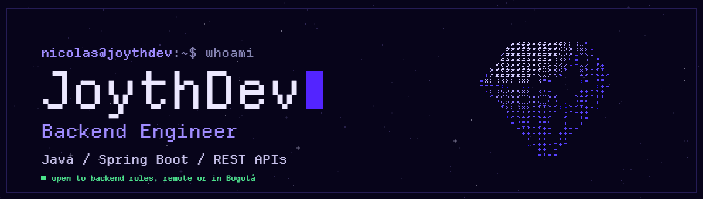
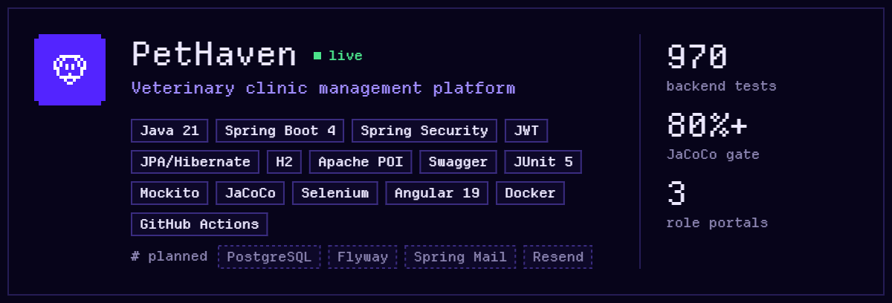
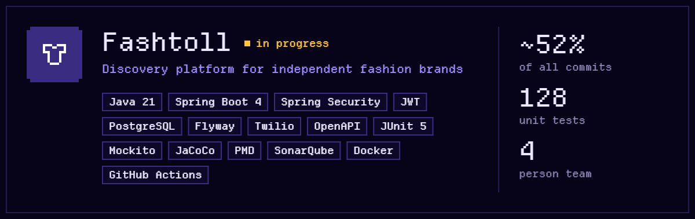
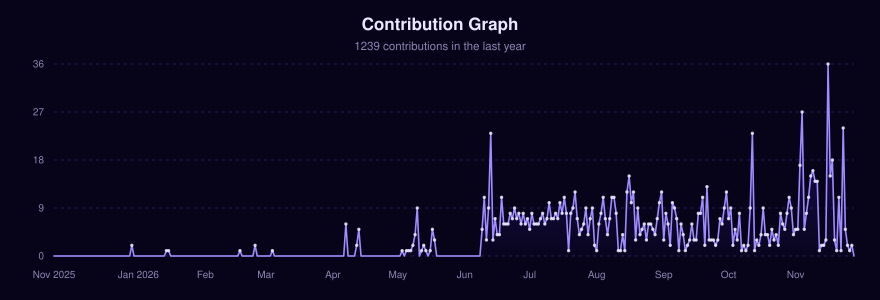

<b>English</b> · <a href="README.es.md">Español</a>

  
  
  
  

### `~/about`

I build **robust, scalable backend systems** with Java and Spring Boot, and I care about what happens after the code is written: tested, deployed, observed, and actually useful to someone.

- Based in **Bogotá, Colombia**, open to remote internships and junior roles.
- **Systems Engineering** student at the **Pontifical Javeriana University**, specializing independently as a backend engineer.
- Deep in the **Java + Spring Boot ecosystem**: REST APIs, Spring Security, testing, persistence.
- Constant learner beyond the code: **deployment, QA, DevOps, testing strategies and agentic development**.
- Goal: join a team where I can ship **reliable services that generate value fast**, and grow toward product engineering.

### `~/principles`

I want to move beyond writing code; I want to build products. My compass:

- **Value first.** The best solution is the one that solves a real problem quickly, not the most elegant one that solves nothing.
- **Quality as a habit.** Testing (JUnit 5, Mockito), SOLID principles, clean code, static analysis. Bugs caught early are cheap.
- **Ship it.** Containerized apps, CI/CD pipelines and deployment awareness. Software only creates value when it's running in production.
- **Think in systems.** Studying software architecture, systems design and distributed systems to understand *why* things scale, not just *how*.

### `~/projects`

Real-world projects to sharpen my craft, from idea to a tested, secured, deployable product.

A fullstack system that digitizes a veterinary clinic specialized in **dog and cat hospitalization**: a Spring Boot **REST API** consumed by an **Angular SPA** with three role-based portals. Vets log treatments with automatic stock deduction and download clinical histories as PDF; owners follow their hospitalized pets; admins manage staff, the medicine inventory (Excel import included) and business KPIs.

- **Status:** deliveries 1–3 complete and **[live in production](https://pethaven-zeta.vercel.app)** (SPA on Vercel, API on Render), with 2 Selenium E2E cases and a GitHub Actions CI pipeline. Deployment and infrastructure are still being refined.
- **My role:** **backend lead of a four-person team** and main contributor. I designed the JPA/Hibernate domain model, led the move from Thymeleaf to a layered REST API (DTOs, validation, centralized errors, Swagger), built the KPI endpoints, medicine management with Excel import and the backend test suite, and was the main contributor to the security layer: Spring Security with JWT login, BCrypt passwords and the role- and ownership-based permission matrix.

A Spring Boot platform that connects local fashion brands with conscious shoppers: brand profiles, product catalog and search, wishlists, follows and reviews. It started as a four-person university project for CEIBA, a fictional company, and I'm now re-engineering it as a production-grade backend.

- **My role:** backend developer, product owner and configuration manager; top contributor to the repository.
- Built the wishlist, followed-brands and product/brand review modules end to end (entities, DTOs, mappers, services and REST endpoints), added SMS notifications with Twilio, and set up the CI/CD pipelines, JaCoCo coverage reports and API docs published automatically with Scalar.

### `~/stats`

  
  

  

  <picture>
    <source media="(prefers-color-scheme: dark)" srcset="https://raw.githubusercontent.com/JoythDev/JoythDev/output/github-contribution-grid-snake-dark.svg">
    <source media="(prefers-color-scheme: light)" srcset="https://raw.githubusercontent.com/JoythDev/JoythDev/output/github-contribution-grid-snake.svg">
    
  </picture>

### `~/contact`

Let's talk about backend development, architecture, or tech in general: **[nicolas.joya.dev@gmail.com](mailto:nicolas.joya.dev@gmail.com)** or **[LinkedIn](https://www.linkedin.com/in/nicolas-joya/)**. More about my work at **[joythdev-portfolio.vercel.app](https://joythdev-portfolio.vercel.app/)**.

<em>"Code has become a commodity; system architecture, constraints, and business context are the real engineering frontiers."</em>

<strong>Thanks for visiting! Feel free to explore my repositories.</strong>

